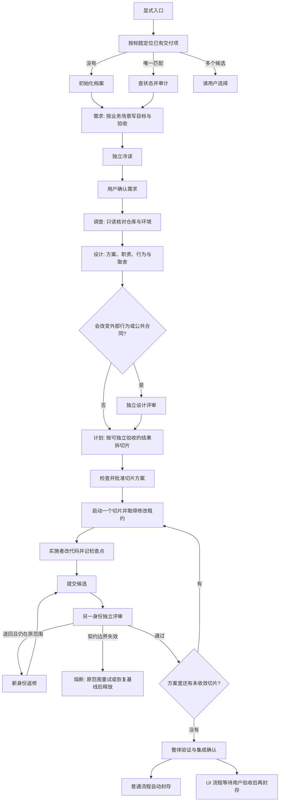

# DLoop 工作流说明

本文根据公开仓库 [qwofa/DLoop](https://github.com/qwofa/DLoop) 的冻结版 **v4.0.3** 整理，供本地对照阅读。依据的提交是 `bd3e719`（2026-10-21，`Merge pull request #15`，说明为增加 Claude Code / OpenCode 宿主支持）。仓库自述已冻结；升级会把旧作业整批归档，不在新版本里续跑旧作业。

DLoop 是一套装进 Unity 工程、由编码 Agent 执行的长任务交付流程。它把需求、调查、设计、计划、分步实施、独立评审和验证收成一份可恢复的交付档案，并在实施时独占项目工作区。人主要确认会改变结果的决定，并在界面任务结束时验收；已确认范围内的推进由协调者持续做下去。

局部小改不进入这条流程，直接交给编辑器里的普通 Agent。

## 1. 它实际交付什么

一次 DLoop 作业围绕一个功能（交付项）推进，产出四类东西：

| 产物 | 内容 |
|---|---|
| 交付档案 | 六个阶段的 Markdown 总览、业务术语表、生命周期清单 `feature.json`，以及按需增加的专题文档 |
| 实施记录 | 切片方案、任务包、检查点、实现候选、独立评审快照、验证结论、未验证边界和残留风险 |
| 项目改动 | 在授权写入范围内改 Unity 工程；Git 不自动提交、不自动推送；SVN 只在本地归组，不提交服务器 |
| 界面验收材料（仅 `/dloop-ui`） | Prefab 截图、内部交互模型、场景验收记录，以及统一的 `ui-delivery.html` |

对外是否可以声称“整体完成”，只看状态里的 `delivery_summary.completion_claim`。候选还没形成、还在待评审、已经熔断，或界面任务还没取得最终验收时，流程不允许把任务说成做完。

## 2. 适用边界

进入 DLoop 的条件是：任务至少包含一个实施切片，并且需要跨多轮交接、独立评审和最终验证。

下面这些情况停在普通请求，不初始化档案：

- 只改一处文案、一个明显错误，或一次就能做完的局部修改。
- 讨论工作流本身，没有要求按交付流实施。
- 没有可实施的代码切片，只想写文档或做调查。没有实现候选时不能走最终验收。
- 用户没有显式选择入口。界面、Prefab、UI 这些词不会自动打开 UI 流程。

需求规模按“结果能否分开验收、有没有必须先定的共同依赖、是否需要跨轮交接”来判断，不按字数、文件数或界面数量决定。

## 3. 系统由哪几块组成

DLoop 自己不调度模型，也不保存模型密钥。宿主负责对话、读文件、跑命令和拉起子 Agent；确定性状态全部交给项目里的 Python 工具。

```text
用户
  │  显式入口：$dloop / $dloop-ui 或 /dloop / /dloop-ui
  ▼
主协调者（当前对话里的 Agent）
  │  读 Skill，调用工具，创建下游子 Agent
  ├── 冷读 / 设计评审 / 实施者 / 候选评审 / 返修 / 最终验收
  │     各自只看工具投影出的角色材料，不继承实施对话
  ▼
FeatureArchive（Tools/FeatureArchive/feature_archive.py）
  │  档案、门禁、租约、候选、快照、分享
  ├── 可选 MCP：dloop_mcp.py（状态、模板、四类提交）
  └── Unity 编辑器截图包（仅 UI 采集）
        通过 Unity MCP 在已打开的编辑器里执行
```

支持的宿主是 Codex、Cursor、Claude Code、OpenCode。四者共用同一套 Skill 正文、同一套工具和同一份项目档案。DeepSeek 等模型由宿主自己配置，DLoop 不按模型名分支。

| 宿主 | 功能开发 | 界面开发 | Skill 安装位置 |
|---|---|---|---|
| Codex | `$dloop` | `$dloop-ui` | `.agents/skills/` |
| Cursor | `/dloop` | `/dloop-ui` | `.agents/skills/`（Cursor 直接读这里，不复制到 `.cursor/skills/`） |
| Claude Code | `/dloop` | `/dloop-ui` | `.claude/skills/`，正文与 `.agents/skills/` 保持一致 |
| OpenCode | `/dloop` | `/dloop-ui` | 发现上述两个目录，不再复制第三份 |

两条 Skill 都设置了 `disable-model-invocation`，模型不能因为对话里出现相关词就自己启动。

运行环境要求：

- Windows、PowerShell、Python 3.10+、Git 客户端。
- 目标是已打开的 Git 或 SVN Unity 工程。SVN 工程也要有 Git，因为阶段快照存在本地 Git 库里，不写 SVN 服务器。
- Unity MCP 按能力接入，不绑定某一家实现。普通开发用它读场景、改资产、跑测试；UI 流程还要求能在编辑器进程里执行 C#，调用随安装部署的截图器 `Dloop.Editor.DloopUiCapture`。
- 可选的结构化入口需要 `uv` 和 MCP Python SDK。命令行核心只用 Python 标准库。

## 4. 两条入口的差别

两条入口共用档案、阶段、切片、租约和评审。差别在人什么时候必须出面，以及要不要采集真实界面。

| | 普通 DLoop | DloopUI |
|---|---|---|
| 入口 | `$dloop` 或 `/dloop` | `$dloop-ui` 或 `/dloop-ui` |
| 初始化配置 | 省略，使用默认严格合同 | `--configuration dloop-ui-v1`，并登记需求来源文件 |
| 开工前给人看的内容 | 按业务场景整理需求，确认会改变目标、合同或验收的分叉 | 四类材料清单：预制体、协议、配置、需求描述。按切片说明哪些能开工、哪些被缺项挡住 |
| 需求与设计的地位 | 经冷读和用户确认后成为已批准材料 | 保持内部材料；用户确认的是开工清单，交互初稿不单独批准 |
| 实施中的额外材料 | 任务包里的验收场景和验证记录 | 每个验收场景一份场景记录，并尽早做真实入口冒烟 |
| 结束条件 | 切片全部收敛、整体验证完成后自动封存。人可以按需验收，不作为冻结前置 | 必须先展示当前交付并取得用户对产品结果的验收，然后才能封存 |
| 验收载体 | 验证阶段的 Markdown | `06-validation/ui-delivery.html`，游戏内验收的同一次回复即可登记 |

## 5. 角色怎么分工

主协调者待在用户所在的对话里。它读常驻 Skill，查状态，写正式文档，决定下一步，并在材料齐全后创建下游上下文。下游角色不读常驻入口，也不再派生下一位实施者或评审者。

| 角色 | 做什么 | 能不能改产品 |
|---|---|---|
| 协调者 | 路由、写六类文档、批切片方案、交接、收口、冻结 | 实施进行时不抢租约；文档按当前阶段的写入目标维护 |
| 冷读 | 没有前序上下文，只根据指定正式材料回答一个入口问题，标记“直接说明 / 只能推断 / 没有说明 / 有歧义” | 只读 |
| 设计评审 | 实施前审查会改变外部行为的模块、公共接口、状态归属、安全或回滚 | 只读。未通过不得开工 |
| 实施者 | 在授权路径内改代码和资源，跑已登记验证，提交检查点和候选 | 只能改任务包 `write_scope` 里的路径 |
| 候选评审 | 对照需求、批准设计和真实 diff 给出通过、失败或未验证 | 只读。执行身份必须和实施者不同，自评会被拒绝 |
| 返修者 | 按评审问题在原范围内修，使用新的执行身份 | 原写入范围。边界变了就停止，转入熔断或新切片 |
| 最终验收 | 从整体业务流程核对跨切片结果，形成技术符合性建议 | 只读。普通流程里这是建议；UI 流程里用户验收另行登记 |

交接时协调者先调用 `prepare-handoff`。只有 `handoff_ready: true` 才把工具生成的短任务消息和读取命令交给下游。任务消息里是交付项、角色和必要的执行身份，不复制需求正文，也不把实施对话带过去。下游用 `context-summary` 自己读取正式材料。角色视图是整份给出的：身份不对、材料过期、候选被改过、还有未结束的实施或评审时，工具只返回阻断和下一步，不给半份合同。

调查阶段是唯一允许并行的地方。多个互不依赖、只读、能各自交回证据的问题，可以由协调者派子 Agent 同时查。分支不能改项目、不能做需求或设计决定、不能再派下一级。协调者等齐后自己写入调查结论。实施、评审、返修始终单线。

## 6. 一次功能开发怎么走

协调者每次进入、切换或从异常恢复时，先跑 `workflow-status` 和只读 `audit`，再把当前业务动作映射成固定标识，用 `workflow-rules` 取回该动作的规则正文，然后按 `delivery_view` 里的下一动作推进。机器给出的阻断原样返回，不手改状态文件。



下面按阶段说明每一步在做什么。阶段目录固定为：

`01-requirements` → `02-investigation` → `03-design` → `04-plan` → `05-implementation` → `06-validation`

依赖只能从上游指向下游。同一层文档用非阻塞的 `related_documents` 关联。术语表是唯一允许的同层硬依赖：`terminology → requirements.overview`。

### 6.1 定位或创建

当前对话只处理一个交付项。协调者用用户给出的自然标题或业务上下文去对现有档案：唯一匹配就恢复；没有匹配才创建；有多个合理候选就请用户选。

新建命令：

```powershell
python Tools/FeatureArchive/feature_archive.py init `
  --feature-id building-interaction `
  --title 建筑交互
```

`--feature-id` 只接受小写英文、数字和连字符。初始化生成：

- 根上的 `README.md` 和生命周期清单 `feature.json`
- 六个阶段目录，每个目录一份总览 `README.md`
- `01-requirements/terminology.md`

内容简单时每类只维护这份总览；证据放不进总览才加专题文档。初始化不会预生成一堆空白专题。档案先写到临时目录，再整体提交，失败时不留半套目录。

已经存在且结构完整时，再次 `init` 返回 `unchanged`。旧版本目录、旧合同、缺字段的档案会被拒绝，不自动迁移。

### 6.2 需求

需求总览按人能单独判断的业务场景来写：谁、在什么初始条件下、做什么、应看到什么结果。影响决定的范围、代价、风险和非目标写在前面。场景名称会一直用到计划和验收，不再另写一套摘要。

第一次需要人做决定时，协调者一次给出已经核实的事实、待决定问题、依赖、可逆边界和推荐方案。交给用户的是会改变目标、外部合同、状态模型、高风险动作、成本量级或最终验收的分叉。实现细节未知、但场景已经清楚时，交给调查，不要求用户先拆任务。

术语只收录“同一个词有两种理解，而且会改变范围或职责”的业务概念。代码标识、节点名、无歧义的自然语言不进术语表。候选术语在第一次需求共识里一批确认。已确认术语在正文里用粗体链接指向术语表；只改名字用 `rename-term`，改定义则走语义变更和下游刷新。

需求共识前可以做一次独立冷读：换一个没有参与写作的子 Agent，只读指定材料，看没有上下文的人能否复述出谁的问题、改完的结果和范围边界。冷读通过后再请用户确认。确认绑定的是当时的需求快照；之后需求语义变了，下游的架构批准和最终批准会一起失效。

### 6.3 调查

调查只记录仓库、环境和外部系统能够证明的事实，以及仍然未知的点。它不把推测写成设计，也不修改产品。

可以并行的调查问题要事先写清：问什么、允许读哪些材料、什么时候停。协调者汇总时要核对互相矛盾的证据，再写入正式调查文档。

UI 任务的调查更具体，见第 8 节：先从需求抽出可见表现和操作去向，再找承载这些需求的现有 Prefab，而不是先把整个 UI 目录扫一遍。

### 6.4 设计

设计基于已确认需求和调查证据，写清方案、职责、行为和取舍。显示信息要落到对象、区域和已经核实的数据来源。数据还不知道时，记下具体缺什么，不用空值或另一种排序冒充完成。

下面这些变化必须在实施前做一次独立设计评审，评审者不能是方案作者：

- 新增、拆分或合并一个承担独立职责的模块
- 改变公共接口、跨模块职责或状态归属
- 改变权限、数据安全或回滚约定
- 引入会改变外部可观察行为的配置、错误模式或执行顺序

授权范围内、外部行为不变的内部整理，由实施者决定，交给后面的候选评审，不再单开一次架构确认。设计评审未通过或未验证时不能开工。重大架构上的高杠杆分叉，可以再增加一次给用户的架构确认；调查、计划、普通实现和修复不再加人审点。

### 6.5 计划与切片方案

计划按“可以分别接受或退回的结果”拆实施切片。完成一个结果所需的代码、配置、接线和验证通常留在同一切片里。不会因为文件落在不同目录，就把界面、逻辑和测试拆成三次交接。

两个切片必须同时改同一份责任、互相等待，或无法分开验收时，优先合并，或先把共同依赖定下来。合并（包括整个功能放进一个切片）要写明不可分的原因，或少一次交接的具体收益，以及合并后共同承担的阻断范围。“这是一个完整功能”“它们改同一个文件”本身不算合并理由。

计划正文用简短列表或表格把需求场景、切片结果、前置依赖和验收依据连起来。延期、复用或依赖缺失的结果也要有去向。形成第一版或改边界时，协调者自己做一次语义自检：场景都有承接、责任不重叠不遗漏、依赖顺序能执行、每次拆分值得一次交接。这不是额外的计划评审角色。

马上要启动的切片补全契约；后面的切片先保留结果、边界、依赖和验收方向，临近实施再细化。

机器侧的切片方案是另一份声明，用 `check-slice-plan` 检查、用 `approve-slice-plan` 批准。每个切片声明直接前置和直接替代关系。工具生成有向图和实时资格，但图不会自动启动或验收任何切片。没有当前批准方案、目标不在方案里、或资格不够时，`start-slice` 直接拒绝，不会偷偷把方案扩大。

### 6.6 实施闭环

任一时刻全工作流只有一个实施切片持有修改租约。租约来自当前项目的 Git 或 SVN 工作区。另一个交付项还占着工作区时，本项不能开工，也不能进入最终批准。

一个切片的事务顺序是：

1. 协调者根据已批准且仍然新鲜的需求、设计和计划，生成任务包和切片契约。
2. 契约检查七项：能否独立验收、强依赖是否可用、有没有结构性未知、影响是否形成闭环、用户能否观察到验收、有没有回归保护、能否安全回退。检查失败拿不到租约。
3. `start-slice` 再次执行同一门禁，通过后占用工作区，并把执行身份交给实施者。
4. 实施者只改 `write_scope` 里的项目相对路径。目录包含其子项，不支持通配符。生成器（绑定、协议、配置）开工前要跑项目已有的只读预检查，把预计写入的预制体、代码和 `.meta` 填进 `generated_write_scope`，且这些路径必须已经被 `write_scope` 盖住。
5. 有意义的节点记检查点：完成一个验收场景、改了关键数据流、引入依赖、第一次验证失败、准备修上一轮失败。中间检查点可以只跑验证集合的一部分。
6. 最后一条检查点必须覆盖契约里登记的全部验证，并且全部通过。然后 `submit-slice` 用真实工作区快照固定候选。范围外有改动会拒绝提交；提交之后工作区再变，会拒绝评审。
7. 协调者另开一个不继承实施对话的评审上下文。评审对照需求、批准设计和 diff，可以按风险附加负向或边界测试，但这些证据不是通过的格式门槛。
8. 通过后释放租约。失败且仍在原批准范围内，用新执行身份返修，产生新候选和新的评审快照，旧快照保留。
9. 当前方案里的切片全部收敛，且至少有一个已接受的实现候选之后，才进入整体验证。

任务包引用相关需求场景和必要的原始来源。交接时工具会补上未引用的需求入口和设计入口。实施者和评审者核对的是原意、设计和实际结果，不只核对方案自己是否自洽。

验证强度只有三档，由协调者按风险写入契约，全流程复用这一结论：

| 等级 | 适用变化 | 必要验证 |
|---|---|---|
| `targeted` | 边界清楚的局部实现或返修 | 直接覆盖变化、受影响调用边界和稳定回归场景 |
| `module_full` | 共享核心、公共协议、持久状态、安装生命周期或测试基础设施 | 受影响责任域及其稳定公共边界的既有测试 |
| `project_full` | 正式发布、真实宿主集成、影响范围圈不住，或定向验证已经露出跨模块回归 | 项目定义的发布前完整测试 |

实施中只需要加强验证、不改变业务边界时，用 `supplement-slice-validation` 提高等级或追加方法。旧的最终检查点随之失效。降低强度、删掉原验证，或借这个入口扩大授权，都不会被接受。范围、依赖、验收或回退本身变了，走熔断，不走补充验证。

普通测试失败留在当前实施者手里继续诊断和重跑。下面这些事实一旦明确，就熔断并停止继续改：

- 业务结果或验收实质变了
- 范围外的内容变成必需
- 强依赖失效
- 必须改公共或存量数据
- 必须破坏不变量
- 无法再独立验收
- 安全回退失效
- 契约里声明的特有熔断条件命中

熔断后只有两个收口：在原任务包、原契约、原方案绑定和原写入范围内用新身份重试；或者人工把工作区恢复到执行前基线，再释放租约。需要前置切片、替代切片、扩大范围或重新划分时，先终止原切片，再改方案、建新切片。工具不会自动回退工作区。

只是漏登记了仍然属于原业务授权的文件时，可以用 `amend-scope` 保留成果并补上具体文件路径，然后以新身份重试并重新评审。这不适用于实际扩大了业务范围的情况。

### 6.7 验证、封存与清理

进入验证前，需求、设计和计划不能处于过期或阻塞，也不能还有没消费的依赖版本。进入冻结前，六个阶段的文档都不能是草稿、过期或阻塞，验证结论必须是通过，未验证边界和残留风险必须写成“无”或“已记录”。

验证入口按需求里的场景名称逐项对照实际结果，不把需求抄成第二份规格。开头写本次变化、实际偏差、未验证部分和仍要人判断的事项。编译通过、字段存在、规划截图，都不能代替运行结果。

整体验证同时核对：

- 全部已接受候选，以及每个候选绑定的方案版本
- 每份评审的结论是通过、执行身份不同于实现者、候选摘要一致
- 工作区仍等于最后一个已接受候选的防护摘要
- 一份集成确认 JSON：结果为通过，并带上候选集合摘要和工作区防护摘要

集成确认表示负责人确认了当前集成结果。它不证明某条测试命令已经跑过；测试记录仍在项目自己的测试运行器或验证入口里。

普通 DLoop 在材料就绪后自动冻结，不等用户说“验收通过”。用户明确要求先验收、暂停，或已经退回结果时，按用户的指示处理。冻结表示这份交付记录封存，不锁项目代码，也没有解冻入口。之后的普通调试直接交给普通 Agent。还要 DLoop 管理下一轮时，另建交付项。

冻结默认保留 30 天。到期后 `detect-cleanup` 只把状态标成待清理，不删文件。真正删除必须先预览，用户在当轮明确授权，且预览允许，才加执行参数。多个目标是全有或全无。

SVN 工程在检查点和冻结后运行 `sync-svn-changelist`，把本交付项的正式产物和当前切片差异归到本地提交组。这不是服务器提交。Git 工程跳过归组，保留已有暂存区，不自动 `git add`、提交或推送。Git 子模块有变化时，要在子模块工程里单独跑工作流。

### 6.8 继续、暂停和回退

回到项目后仍用原来的入口，说明功能名称和意图，例如继续某功能、先暂停并保留成果，或指出要调整的行为。工作流读已保存的进度。

| 用户意图 | 处理 |
|---|---|
| 暂停，代码先留着，回去重议 | 保留文件、执行身份和租约。确认仍走原范围后交还原实施者 |
| 在原批准范围内改实现 | 活动切片交还原实施者；评审没过的走返修 |
| 明确撤销本轮实施 | 原执行身份提交 `interrupted`，工具把授权范围恢复到这次执行开始前的基线并释放租约 |
| 退回到某个阶段或某个保存点 | 先停写入，列出保存点，预览文件和切片影响，确认后执行恢复。恢复前会先保存当前现场 |
| 已冻结还要继续用 DLoop | 从历史快照 fork 出新交付项，重新登记目标和批准。冻结作业不能原地恢复 |

对话或进程意外退出不会自动把任务标成完成、失败或中断。再次进入时，活动执行身份还在，就把工作交还该身份。确认无法继续时，才显式登记中断。

## 7. 文档怎么保持不过期

每份 Markdown 带统一元数据：文档标识、内容状态、语义版本、正文指纹、依赖位置、已消费的依赖版本。AI 改完一批文档后必须显式调用 `confirm-change`，并声明这次是不是语义变化。工具不猜测文字有没有业务含义。

- 语义变化：相关文档补丁版本加一，直接依赖者标为过期。
- 非语义变化（排版、错字、含义不变的措辞）：更新指纹。若这份文档自己是待刷新的，同时确认它已经消费了当前依赖版本，不再往下传播。

使用设计、计划或更下游的材料之前，要看刷新队列并做新鲜度断言。过期文档不能作为执行输入。冻结档案不参与刷新。

普通 Markdown 链接只负责导航。是否触发下游过期，只看元数据里的 `dependencies`。

交付档案是这次执行的记录。只有用户在当前任务里明确指定目标时，才把内容写进项目的长期文档或知识库。

## 8. DloopUI 比普通流程多做的事

UI 入口复用上面的全部阶段。额外增加的是：用真实 Prefab 核对需求落点，用开工清单挡住材料不齐的切片，并在结束时用一张 HTML 把验收导航交给人。

### 8.1 登记来源并初始化

来源必须是已经存在的本地 UTF-8 文件。网页内容先存成带原链接和定位的本地摘录，再登记这个文件。初始化只登记来源，不替换已有档案的来源。

```powershell
python Tools/FeatureArchive/feature_archive.py init `
  --feature-id <stable-feature-id> `
  --title <中文功能标题> `
  --configuration dloop-ui-v1 `
  --source-document <需求文件或已有资料>
```

`ui-model.json` 由工具生成，不手改。计划和标注图也不手改。

### 8.2 找 Prefab 并截图

每条有可见表现、用户操作或界面去向的需求，形成一条调研简报：业务键、可观察描述、来源定位、页面或文案线索、置信度，以及匹配结论。

| 匹配结论 | 含义 |
|---|---|
| `matched` | 指向 `Assets` 下真实存在的一个 `.prefab` |
| `ambiguous` | 至少列出两个真实候选 |
| `not-found` | 查过但没有唯一资产 |

找不到、对不上、单项截图失败或目标不可见，都记成正常跳过。不为了补截图去创建占位界面。未提供 Prefab 也不构成“可以新建 Prefab”的授权。用户明确要求补资源时，先由用户决定单独做资源，还是把范围拆出去。

匹配成功后，`ui-investigate` 返回采集请求。协调者通过 Unity MCP 确认打开的是同一个工程，设置环境变量 `DLOOP_UI_CAPTURE_REQUEST`，调用 `Dloop.Editor.DloopUiCapture.CaptureFromEnvironment()`。截图器把 Prefab 放进临时环境，输出 1920×1080 截图、节点层级和可见矩形，并恢复原来的活动场景。采集清单再交回同一次调研。截图只证明可见现状和节点位置，不证明运行时交互。

没有已匹配 Prefab 时不需要 Unity。Unity 整体不可用时停止并修环境，不把整次失败记成某个 Prefab 的业务跳过。MCP 不可用时，不要求用户关掉正在用的工程去换批处理模式。

### 8.3 开工清单

调查之后、第一次实施之前，按每条需求核对四类材料：

- 预制体：必须是调查里匹配到的真实文件
- 协议：沿用既有能力时引用真实文件，标为 `inherited`
- 配置：同样要引用真实文件；确实没有这类依赖才标 `not_applicable` 并写理由
- 需求描述：要有触发、操作、预期结果和必要异常。文件在，不等于业务事实齐

每份登记过的需求来源，要么被某条需求引用，要么写进“本次明确不做”，并出现在确认页最前面。不能只做容易的段落，把困难需求留在来源里不提。

`slice_requirements` 把批准方案里的每个切片映射到它直接使用的需求。缺项只阻断使用这些材料的切片及其后续依赖；材料和依赖都齐、且用户确认过的切片可以先做。依赖边界还没查清时先调查，不能删掉映射来绕过缺项。

材料状态变成可开工或局部可开工后，协调者按业务场景把预期结果和四类依据展示给用户，等真实回复，再用 `stage-action --stage ui-baseline` 记下回复定位、原文和当次摘要。AI 自己的评审、资料补齐、沉默，以及更早的一句泛泛的“继续”，都不算这次确认。只改用途措辞、含义不变时，可以声明非语义变更并保留原确认。

### 8.4 内部交互草稿

计划阶段为每条没有跳过的需求提交标注：

- `change`：在截图上标出区域，写本次修改和用户能看到的结果。接线、刷新、改显示或布局都属于修改
- `reuse`：现状已经满足需求，产品不需要任何修改
- `target-not-visible`：截图成功，但无法可靠定位目标，并说明原因

`ui-publish` 一次完成模型保存、检查、统一 HTML、编号图和归档表格。初期草稿可以不完整，也不单独批准。正式实施仍要先通过开工确认。

### 8.5 尽早做真实入口冒烟

实施一开始就写场景验收记录，先填准备条件、入口和最短操作。优先完成四项最小冒烟：打开真实入口、看到非空业务数据、正常退出、重新进入或刷新后状态正确。做不到就保持 `unverified`，写下具体缺什么，并尽早请用户协助；同时继续做不依赖该环境、且已经授权的工作。

每条场景记录自己的验证层级：

| 层级 | 含义 |
|---|---|
| `static` | 静态检查 |
| `isolated` | 受控数据下的客户端隔离验证 |
| `runtime` | 真实产品环境里的实际操作 |

前两档不能写成实际验收通过。用户明确同意延期时记下依据。

### 8.6 最终展示

候选被接受后，用内置模板生成 `06-validation/ui-delivery.html`。默认页面回答四件事：改了什么、去哪里验收、实际验证了什么、还差什么。操作步骤和截图定位默认折叠。已有截图来自调研时登记的原图；布局没变的纯逻辑或文案修改，复用已有定位，不重新全量采集。

必要验证还没完成时也可以生成当前成果页，但 `delivery_ready` 为 false，最终批准和冻结仍被挡住。用户可以在游戏里直接验收。同一次真实回复加上当前集成确认，用 `stage-action --stage final` 登记。未收到回复不会自动批准或封存。行为错误走返修和独立评审，不靠改验收报告把产品说成通过。

## 9. 档案、工具与目录

活动材料固定在目标工程内，不跟编辑器的当前工作目录走。公开命令从 `Tools/FeatureArchive/feature_archive.py` 的安装位置确定项目根。

```text
<Unity 工程>/
  .agents/skills/dloop/            Skill 与阶段规则
  .agents/skills/dloop-ui/
  .claude/skills/                  与上面两份 Skill 的同源副本
  Tools/FeatureArchive/            命令行、MCP 脚本、测试
  Assets/.../Dloop Ui Capture/     Unity 编辑器截图包（安装时放入）
  .scratch/
    dloop-v3/v4.0.3/
      outputs/<feature-id>/        正式档案
        01-requirements/ ... 06-validation/
        feature.json
      snapshots/<feature-id>.git   本地快照库，不进入源仓库分支
      shares/<feature-id>/<id>/    只读分享快照
      captures/<feature-id>/       UI 临时截图
    dloop-history/<旧版本>-.../    升级时归档的旧作业，只供查阅
    dloop-install-backups/         升级时的安装载荷备份
    outputs/                       未纳管的临时分析，不作为正式输入
```

正式输入（任务包、检查点、候选、评审）只能来自该交付项对应的阶段目录。工具提供 `prepare-action-input` 生成当前字段合同，避免按旧示例手写 JSON。

已连接并核对过项目根的 DLoop MCP 时，优先用结构化工具，不再手写那四类 JSON：

| 工具 | 作用 |
|---|---|
| `dloop_status` | 当前状态、阻断和下一动作 |
| `dloop_prepare_input` | 返回当前模板和填写要求，不落模板文件 |
| `dloop_submit_task_package` | 保存任务包，登记契约草稿 |
| `dloop_submit_checkpoint` | 保存检查点；相同内容和工作区的重复提交复用记录 |
| `dloop_submit_candidate` | 固定候选并进入独立评审 |
| `dloop_submit_ui_baseline` | 保存开工清单。用户确认仍要另走 `stage-action` |

其余动作，以及 MCP 没连上时的全部动作，继续用命令行。安装器不改写 Codex、Cursor、Claude Code、OpenCode 的 MCP 配置；连接要按 `docs/structured-tools.md` 自己加。升级后旧 MCP 进程会要求重启，不会继续跑旧代码。

状态查询默认只给一份 `delivery_view`：当前阶段、能否推进、阻断、唯一下一动作、批准摘要和当前候选。排查历史、基线或完整检查点时才加 `--include-details`。

需要给工作流外部的人看时，`export-share` 导出一份不可变只读快照，包含 Markdown、`feature.json`、可选 UI 模型、媒体证据和可归属的摩擦记录。快照不能拿回来当正式输入执行。导出过程中来源变了，这次结果作废，调用者按最新状态重新导出。

摩擦记录是旁路日志。用户指出重复劳动，或角色实际遇到重复找材料、格式试错、交接被退回时，用 `friction-note` 记下目标、多做的动作和证据路径。它不参与批准，缺记录也不挡住交付。

## 10. 快照

每个作业有一个独立的本地 Git 快照库：`.scratch/dloop-v3/v4.0.3/snapshots/<feature-id>.git`。它不改源仓库分支和暂存区，也不提交 SVN。

工具会自动保存作业起点、切片和返修开始、每条合法检查点（含失败和熔断）、固定候选、评审、批准、确认材料、UI 发布和冻结结果。协调者另外在这些边界手动保存：

| 原因 | 时机 |
|---|---|
| `stage-start` | 某个阶段本轮第一次开始编辑之前 |
| `before-overwrite` | 准备覆盖旧方案或替换一批成果之前 |
| `stage-submitted` | 把阶段材料交给评审或等待用户确认之前 |
| `stage-completed` | 阶段完成时 |
| `pause` / `resume` | 暂停，或从中断恢复前先保存还能读到的现场 |

`snapshot-list` 按时间列出保存点。只想看历史用 `snapshot-export`，当前工程不变。要恢复并继续时，`snapshot-restore` 先给预览，加 `--execute` 才落地，并且会先保存回退前现场。恢复后的实施必须使用新执行身份，最终验证要重做。冻结作业只能查询和导出；要接着做就 `snapshot-fork` 成新作业，旧批准不会被复制成新批准。

缓存清理和卸载都保留快照。只有用户明确清理整个作业时，预览和删除才包含快照库。

## 11. 安装、升级与卸载

在目标工程根目录执行在线安装（标签可用时安装 v4.0.3；作者也提供源码安装和 ZIP 安装）：

```powershell
irm https://raw.githubusercontent.com/qwofa/DLoop/main/install.py -ErrorAction Stop | python -
```

成功标志是 `DLoop installed and verified.` 安装内容是两份 Skill、共享工具和 Unity 截图包。Git 工程会在 `.gitignore` 补 `/.scratch/`（已有规则则保留）。SVN 工程追加 `svn:ignore`。安装不配置 Unity MCP，不改宿主的其他 Skill。

版本策略：

- 没有旧安装：安装当前版
- 同版本重装：校验归属后幂等重装，保留现有作业
- 更旧版本：整批归档旧作业、解除工作区占用，再安装新版。旧文档、快照和代码改动保留，但不能续跑
- 更新的版本：拒绝，不读不写
- 降级：拒绝

旧安装里已登记文件被本地改过时，升级会先完整备份再替换。受管目录里多出来的文件也会备份：不冲突的留在原地，挡住新版路径的移进备份，不登记成新版载荷。安装失败会恢复原现场。作者要求工具缺陷在 DLoop 源码里修，再通过新版本安装交付，不直接改项目里已经装好的载荷或安装锁。

卸载移除本版管理的 Skill、工具和截图包，保留交付档案和项目忽略规则。

## 12. 人在流程里实际要做什么

普通功能开发：

1. 在工程根目录安装 DLoop，确认宿主能读 Skill、跑 Python，并且 Unity MCP 连的是当前工程。
2. 用对应入口附上需求或直接描述目标。
3. 确认协调者整理出的业务场景，以及少数会改变目标或验收的取舍。
4. 之后只在出现影响预期的变化或真实阻塞时做决定。也可以随时说暂停、继续或调整行为。
5. 交付时看实际结果、和需求的差异、以及未验证内容。普通流程此时已经可以自动封存；要先验收就明确说。

界面开发在上述基础上增加：

1. 开工前看材料清单：哪些切片能做，缺预制体、协议、配置还是需求描述，缺了会影响什么。
2. 交付时打开 HTML，或直接进游戏验收。页面列出操作、反馈、生效条件和未完成项。
3. 用真实回复接受或退回。返修后重新验收，通过后才封存。

不需要人做的事：手写命令、手工改 `feature.json`、为每个检查点点确认、在每个切片结束时做一次例行验收、替流程执行 Git 提交。清理档案、提交 SVN、发布、打标签、覆盖和删除，都不包含在阶段批准里，要各自单独授权。

## 13. 这套设计里值得单独记住的点

这些是流程本身的结构选择，整理在这里方便对照，不表示本地工作流要照搬命令或目录。

1. **入口显式，小任务不建档。** 长流程只在用户点名后启动，避免一次改字也走完整交付。
2. **协调者和执行者分离。** 实施者不读总控 Skill，评审者不看实施对话。交接物是工具生成的短消息加正式文件，不是把上一段聊天复制过去。
3. **状态以工具为准。** Agent 负责语义判断和正文；版本、过期传播、租约、候选固定、批准失效和能否清理，都由确定性命令决定。
4. **一次只写一个切片。** 修改租约覆盖整个工作流。范围外改动在提交时拒绝，提交后的漂移在评审时拒绝。
5. **按可验收结果拆，不按技术层拆。** 共同依赖先定一次，后面的契约引用同一依据。局部缺材料只挡住使用它的切片。
6. **验证强度写进契约并全程复用。** 风险事实变了才升级。候选评审和最终批准不会自己再跑一套外部测试。
7. **熔断只针对契约边界失效。** 普通测试失败继续修。熔断后保留现场，由人决定原范围重试还是先恢复基线再释放。
8. **UI 用真实 Prefab 和真实回复做门。** 截图证明位置，运行记录证明行为。开工确认和最终验收都要绑定当次用户回复的原文，沉默和旧的“继续”不算。
9. **快照在旁边的 Git 库里。** 源仓库分支、暂存区和 SVN 服务器保持原样，所以暂停、回退和阶段重做有保存点，又不替用户提交。
10. **版本之间不续跑。** 新版本换独立目录，旧作业归档只读。同一作业从开始到结束使用同一套规则。

## 14. 源文档索引

仓库内与本说明对应的主要材料：

| 路径 | 内容 |
|---|---|
| `README.md` | 用户向概述、入口和安装 |
| `AGENTS.md` | 版本边界、审查过滤、不保证旧作业兼容 |
| `CHANGELOG.md` | 至 4.0.3 的行为变化 |
| `docs/installation.md` | 安装、升级、卸载 |
| `docs/dependencies.md` | 环境与 Unity MCP 能力 |
| `docs/structured-tools.md` | 六个 MCP 工具及四种宿主配置 |
| `src/FeatureArchive/README.md` | 命令合同：档案、切片、快照、生命周期 |
| `plugin/dloop/skills/dloop/SKILL.md` | 普通入口与动作路由 |
| `plugin/dloop/skills/dloop/references/` | 需求、实施、评审、验证、快照等阶段规则 |
| `plugin/dloop/skills/dloop-ui/SKILL.md` | UI 入口 |
| `plugin/dloop/skills/dloop-ui/references/model-contract.md` | 调研、标注、开工清单、场景验收的字段合同 |
| `plugin/dloop/unity-editor/Editor/DloopUiCapture.cs` | 编辑器内 Prefab 截图 |
