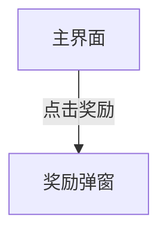

# 工作模式新增约束需求

> 范围：只改 `mode: work` 的工作模式（`work-feature` Skill、`bulings run` / `resume` 的工作模式分支、相关提示词与模板）。独游模式不动。

## 1. 背景

工作模式现在有两个缺口：

1. **预制体绑定靠运行时查找**。代码里用 `transform.Find("Button")`、`GetComponent`、按名字查节点这类方式拿引用，改名或挪层级就静默失效，编译期发现不了。工程里已经有「预制体内脚本自动绑定」的做法，但工作流没要求优先用它。
2. **直接开写**。功能一旦涉及多个页面和脚本，Agent 会在没给用户看整体结构的情况下直接写代码；等到写出来才发现页面关系或数据流向不是用户想要的，返工成本高。

## 2. 目标

- 代码里拿预制体节点引用，**优先走预制体内的脚本绑定**，不用运行时按名字查找兜底。
- 绑定做不到就地生成时，**明确告诉用户哪些预制体需要补绑定**，而不是悄悄用查找方式绕过。
- 大规模功能在写代码前**先出一张页面交互 + 数据流流程图**，用户确认后才进入实现。
- 不改变现有流程的阶段顺序语义：分析 → （流程图确认）→ 实现 → 功能说明。

## 3. 非目标

- 不引入 Unity 批处理编译，不自动改 `.meta` guid。
- 不改独游模式的框架/切片流程。
- 不强制流程图里的图必须是 Mermaid，但默认给 Mermaid，方便在 Markdown 里看。

## 4. 需求清单

### B1 预制体节点绑定：优先在预制体内用脚本自动绑定

**要求**：

- 取预制体里的节点/组件引用时，按这个顺序选方案：
  1. 预制体已经通过序列化字段引用好了目标（`SerializeField` 等）——直接用，不要重新绑。
  2. 工程里有绑定脚本/生成器（例如 `partial class` 的 Bind/Logic 拆分、代码生成器）——按工程的既有方式，在预制体内生成绑定代码并绑定引用。
  3. Unity MCP 可用时，用 MCP 在预制体上生成绑定代码、绑定序列化字段并保存预制体。
- **不允许**把「运行时按名字查找」当成主方案：`transform.Find("X")`、`GameObject.Find`、按节点名 `GetComponent` 这类写法，只有在以下情况才允许，并且必须写进「已知限制」：
  - 该预制体/工程本来就用这套约定（`project.ui.binding` 里写了按名字绑定）；
  - 或者用户明确要求。
- 绑定做不到时（MCP 连不上、预制体是只读/第三方、绑定脚本生成器不存在），**不要自己用查找兜底**：在开发说明的「预制体绑定」一节列出「哪个预制体、哪个节点、要绑什么类型、为什么不能就地生成」，并在回复里讲清楚要用户补哪几个预制体。

**验收**：

- 分析阶段在开发说明里给出每个预制体的绑定方案与「需要用户补绑定的预制体」清单。
- 实现阶段的提示词带上这条规则；Agent 用运行时查找时必须在「已知限制」里说明原因。
- 一个功能全部绑定都能就地完成时，清单写「无」。

### F1 流程图门禁：大功能先出图，确认后再写代码

**要求**：

- **默认所有工作模式功能都走流程图门禁**；`--no-flow` 或 `bulings.flow.enabled: false` 可以关掉。
- 分析阶段在写 `tasks.json` 的同时，必须写流程图文件 `.bulings/runs/<功能名>/flow.md`，内容至少包含：
  - 页面/界面清单与相互关系（哪个页面打开哪个）；
  - 页面交互流程（用户操作 → 界面反应 → 状态变化）；
  - 数据流向（数据从哪来、经过谁、落到哪、谁刷新界面）；
  - Mermaid 图（`flowchart` 或 `sequenceDiagram` 至少一张）。
- 分析结束后**不进入实现**：状态停到 `flow`，命令退出 `2`，打印流程图路径和确认命令。
- 用户看完图后跑 `bulings resume --project <工程> --run <功能名> --confirm-flow`：
  - 流程图不存在或明显是空壳（没有图、没有页面清单）时拒绝，退出 `2`；
  - 通过时在流程图末尾写入确认标记（时间戳），状态进入 `implement`，继续按原有节奏逐项实现。
- 已经确认过的运行，`resume` 不再要求确认。
- 独游模式不受这条门禁影响（它有自己的框架和切片校验）。

**验收**：

- `bulings run` 在工作模式分析完成后退出 `2`，`state.phase == "flow"`，打印 `.bulings/runs/<slug>/flow.md` 和 `--confirm-flow` 命令。
- `bulings resume` 不带 `--confirm-flow` 时提示确认并退出 `2`，不写任何代码。
- `bulings resume --confirm-flow` 通过后写入确认标记，状态进入 `implement` 并开始跑任务。
- 流程图文件不存在时 `--confirm-flow` 拒绝（退出 `2`）。

### F2 流程图文件契约

```markdown
# <功能名> 页面交互与数据流

> 功能名：<feature>    策划案：<path>    生成时间：<iso>

## 页面与入口
...

## 页面交互流程


## 数据流向
...

## 待确认
...

<!-- flow-status: draft -->
```

确认后最后一行变成：

```markdown
<!-- flow-status: confirmed by user at 2026-08-16T10:20:30 -->
```

工作流只认最后一行这个标记，不关心别的格式。

## 5. 配置

```yaml
docs:
  flow:
    enabled: true     # 默认 true；false 时不做流程图门禁
    path: .bulings/runs/{feature}/flow.md
```

也可以按次覆盖：`bulings run --no-flow`、`bulings resume --no-flow`。

## 6. 兼容性

- 已有运行：`state.phase` 里没有 `flow` 的旧状态照常按 `analyze` / `implement` 走；`resume` 只会对新建的运行要求流程图。
- 关闭门禁时行为与现在完全一致。
- 退出码沿用 `0/1/2`：流程图未确认属于「已启动没做完」，用 `2`。

## 7. 验证

- 新增 `tests/test_flow_gate.py`：模板生成、状态标记解析、门禁在 runner 里的停与放行、`--no-flow` 跳过、独游模式不受影响。
- 全量 `pytest` 保持全绿。

## 8. 落地状态

已实现，全量 `pytest` 203 通过。

| 需求 | 代码 | 测试 |
| --- | --- | --- |
| B1 预制体绑定优先顺序 | `pack/skills/work-feature/SKILL.md`「预制体绑定」、`prompts.py` 分析与实现提示词、`unity-mcp.md` | `tests/test_flow_gate.py` 的提示词断言 |
| F1 流程图门禁 | `bulings/flowchart.py`、`runner._flow_gate_applies` / `_stop_at_flow_gate` / `_confirm_flow` | `tests/test_flow_gate.py` |
| F2 流程图文件契约 | `bulings/flowchart.py` | 同上 |
| 配置 | `docs.flow.enabled` / `docs.flow.path`；`--no-flow` / `--confirm-flow` | `tests/test_config.py` |

阶段变化：工作模式的 `state.phase` 多了一个 `flow`（分析 → flow → implement → document → done），`resume` 不带 `--confirm-flow` 时停在这里。独游模式不受影响。
